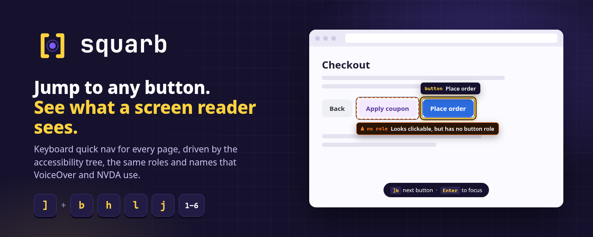

<p align="center"></p>

# Squarb

Squarb is a Chrome extension (MV3) for keyboard quick navigation on any page. Press `]b` for the next button, `[h` for the previous heading, and so on.

It finds things using only **computed ARIA roles and accessible names**, the same data a screen reader uses. On a page with good markup it's a fast power-user tool. On a page with poor markup it shows the problems: clickable `div`s get flagged as you skip past them, and an icon button with no label shows up as `button (unnamed)`.

The keys mirror screen reader quick nav, VoiceOver's letters first and NVDA's for the extras, so what you learn here works when you test with a real screen reader.

## Install (unpacked)

```sh
npm install
npm run brand     # icons and promo art (needs rsvg-convert + Chromium)
npm run build     # → dist/
```

Then open `chrome://extensions`, turn on Developer mode, choose **Load unpacked** and pick `dist/`.

## Keys

`]` + key goes to the next match and `[` + key to the previous one.

| Key | Goes to | From |
|---|---|---|
| `b` | button | VoiceOver |
| `h`, `1`–`6` | heading, heading at level N | VoiceOver |
| `l` | link | VoiceOver |
| `j` (alias `f`) | form control | VoiceOver / NVDA |
| `t` | table / grid | VoiceOver |
| `x` | list | VoiceOver |
| `g` | image | VoiceOver |
| `e` | text field | NVDA |
| `c` | combo box / listbox | NVDA |
| `r` | radio button | NVDA |
| `d` | landmark (`form`/`region` only when named) | NVDA |
| `i` | list item | NVDA |

| Key | Does |
|---|---|
| `]]` / `[[` | repeat the last jump |
| `\` + key | highlight every match; then bare `]` / `[` step through them |
| `\\` | rotor: every element grouped by role, with an **Issues** tab |
| `Enter` | focus the highlighted element (press again to activate it) |
| `Esc` | clear; inside a text field, leave the field |
| `?` | cheat sheet, with the VoiceOver and NVDA equivalents |

You can remap every key on the options page.

**Rules Squarb follows**
- A jump moves a highlight, not focus. Focus only moves when you press Enter, so jumping to a text field never starts typing into it.
- No key is intercepted while you're typing in an input, textarea, select, contenteditable, or textbox/searchbox/combobox.
- Ctrl, Meta and Alt combinations always reach the page.

## How it works

Chrome doesn't give extensions its accessibility tree on desktop. `chrome.automation` is ChromeOS-only, and `chrome.debugger` shows a banner. So roles and names are computed in the content script:

- **Roles and names** come from [`dom-accessibility-api`](https://github.com/eps1lon/dom-accessibility-api), the library behind Testing Library's `getByRole`. Patches on top match Chrome: scoped `header`/`footer`, unnamed decorative `<svg>`, `contenteditable`, `password`/`date`/`file` inputs, and list items inside `role="none"` lists.
- **Exclusion:** `aria-hidden="true"` and `inert` prune subtrees during the walk. Rendering is checked at query time with `checkVisibility()`, which covers `display:none`, `hidden`, closed `<dialog>`/popover and `content-visibility`. While a modal is open, navigation stays inside it.
- **Visually hidden** content (`.sr-only`, `left:-9999px`) stays navigable, because screen readers read it. It's labelled "visually hidden" and drawn on its nearest visible ancestor.
- **Order** is flat-tree order: open shadow roots, slotted content and same-origin iframes are inlined. Cross-origin frames are counted and skipped.
- **Index:** built on the first keypress. A `MutationObserver` records which subtrees changed, and only those are re-walked, lazily on the next query. Names are computed only for elements being shown, and cached until the next mutation.
- **"Looks clickable":** an idle-time scan flags elements with no interactive role that have an `onclick`, a `tabindex`, a pointer cursor that starts on them, or a framework click handler. React, Vue, Preact, jQuery and `el.onclick` handlers are found by a tiny main-world probe (`src/content/probe.ts`), which only sets and clears a marker attribute.
- **UI** lives in one shadow root that's promoted to the top layer as a manual popover, so page CSS can't break it. It supports light/dark mode, forced-colors mode and `prefers-reduced-motion`.

```
src/
  content/
    a11y/        tree walk, roles, names, visibility, index, lint (DOM-only, unit-tested)
    keys.ts      key-sequence state machine (pure)
    controller.ts
    ui/          overlay (highlight, labels, toast), rotor, help
    probe.ts     main-world click-handler probe
  shared/        targets (what each key finds) + settings
  pages/         options + explainer pages
  background/    service worker
```

## Tests and benchmark

```sh
npm test            # vitest + jsdom: roles, exclusion, shadow DOM, iframes, patching, keys, lint
npm run test:e2e    # Playwright loads dist/ into Chromium: key sequences, passthrough, Enter focus,
                    # rotor, help, warnings, and a CDP Accessibility.queryAXTree cross-check
npm run bench       # synthetic 128k-element "PR diff" page; or pass URLs: npm run bench -- <url>…
```

Set `CHROMIUM_PATH` if Chromium isn't at `/usr/bin/chromium`.

Benchmark results (Chromium 155, this machine):

| Page | Elements | Indexed | Build index (1st key) | One jump | Patch after mutation | Clickable scan (idle) |
|---|---|---|---|---|---|---|
| Synthetic PR diff | 128,356 | 16,227 | 61 ms | <1 ms | 0.4 ms | 120 ms |
| Wikipedia "World War II" | 16,940 | 8,032 | 9 ms | <1 ms | 0.3 ms | 19 ms |

## Website

`docs/` is a one-page site for GitHub Pages that runs the real extension code as a live demo. Rebuild it with `npm run site` after changing `src/` or the brand assets. To publish, go to **Settings → Pages**, choose **Deploy from a branch**, and pick your branch with the `/docs` folder.

## Brand

| | |
|---|---|
|  | `brand/logo.svg`: the mark, square brackets around a cursor (`logo-16.svg` is pixel-tuned for 16px) |
|  | `brand/wordmark.svg`, `wordmark-on-dark.svg`: lettering outlined from JetBrains Mono |

Colours: ink `#16122e`, bracket yellow `#ffd23f`, violet `#7c5cff`, warning orange `#ff7a29`.

Generated assets are in `brand/out/`: icons (16–512), Web Store promo tiles (440×280, 1400×560), a 1200×630 social card, and real 1280×800 screenshots (`npm run screenshots`).
